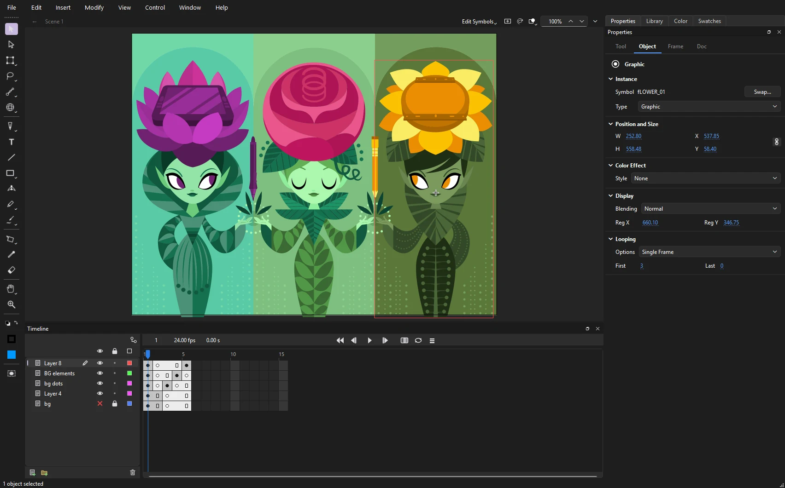

# Phoenix Animate

Phoenix is an open source vector animation app for Windows and macOS. It has the drawing tools, timeline and symbols animators already know, and it opens and saves Adobe Animate FLA files without losing anything.

## [PhoenixAnimate.com](https://PhoenixAnimate.com)

## Building

See [docs/building.md](docs/building.md) to build Phoenix from source and run its tests.

## Design Docs

See [docs/README.md](docs/README.md) for a collection of design docs about how Phoenix was written.

## AI Disclosure

AI was used in the development of Phoenix: its code, tests and documentation were written with the help of AI coding assistants, including Claude.

## License

Phoenix is released under the [MIT License](LICENSE).
