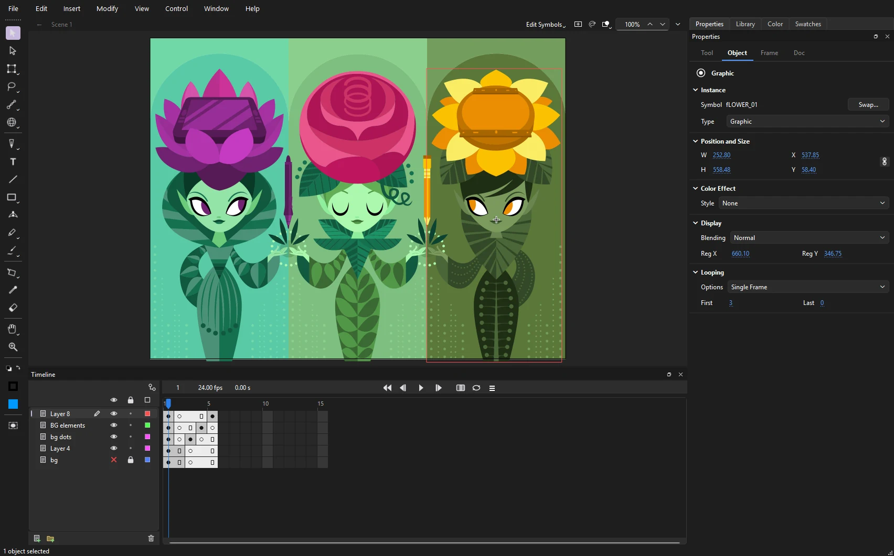

# Phoenix Animate

Phoenix is an open source vector animation app for Windows and macOS. It has the drawing tools, timeline and symbols animators already know, and it opens and saves Adobe Animate FLA files without losing anything.

## [PhoenixAnimate.com](https://PhoenixAnimate.com)

## Building

See [docs/BUILDING.md](docs/BUILDING.md) to build Phoenix from source and run its tests.

## License

Phoenix is released under the [MIT License](LICENSE).
