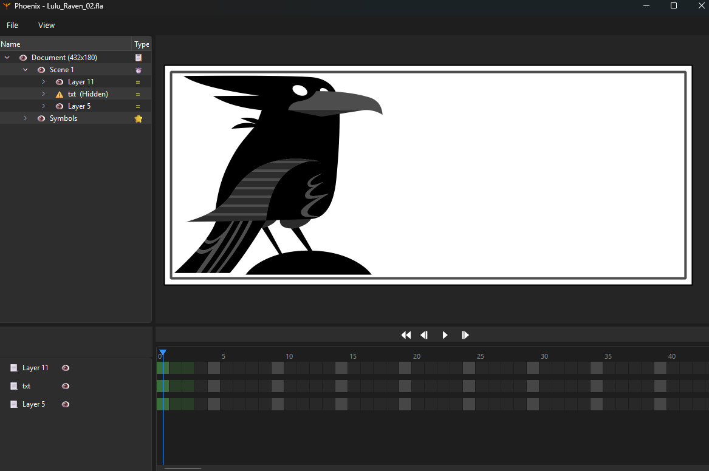

# Pheonix

Phoenix is an experimental Flash FLA parser and renderer. It is being developed out of personal interest as a learning exercise and is not intended to be a supported product.



Performance has not been a focus yet over accuracy.

## Building

### Requirements

- CMake 3.16 or newer
- A C++17 compiler
- Git and a network connection for the first configure: the ActionScript parser
  ([libas3](https://github.com/brendan-duncan/libas3)) is fetched at configure
  time, and so is Qt unless one is already installed (see "Finding Qt"). zlib
  and tinyxml2 are vendored under `src/third_party` and need nothing.

Qt does not need to be installed: the configure step downloads a trimmed Qt 6
(Core, Gui, Widgets, Svg, their plugins and tools, about 40 MB) into
`third_party/qt/` the first time, if it finds none.

### Configure and build

```
cmake -S . -B build -G "Visual Studio 18 2026" -A x64
cmake --build build --config Debug
```

Substitute your own generator; `"Visual Studio 17 2022"` works the same way.

On Windows, prefer a Visual Studio generator over Ninja. Ninja currently fails
in the libas3 dependency, which copies `as3_parser.pdb` after archiving — MSVC
does not emit that file for a static library under Ninja, so the copy errors out
before Phoenix itself is reached.

A Visual Studio generator also finds the MSVC toolchain by itself, so it works
from an ordinary shell. Ninja does not: it needs the compiler already on `PATH`,
which means a Developer Command Prompt, or a shell that has run `vcvars64.bat`.

### Finding Qt

The build looks for Qt in this order, and stops at the first that works
(`cmake/PhoenixQt.cmake`):

1. `-DQt6_ROOT=...` or `-DCMAKE_PREFIX_PATH=...` on the command line
2. the `Qt6_ROOT` or `QTDIR` environment variables
3. a trimmed Qt already unpacked under `third_party/qt/<target>`
4. on Windows, the newest `C:/Qt/6.*/msvc*_64` it can find
5. downloading the trimmed Qt for this machine into `third_party/qt/`

The trimmed archives are release assets of this repository, one per target:
`windows-x64`, `windows-arm64`, `macos` (universal), `linux-x64` and
`linux-arm64`. `cmake/QtArchives.cmake` pins the Qt version and each archive's
SHA-256, and the download is refused if the hash does not match. Options:

- `-DPHOENIX_FETCH_QT=OFF` never downloads
- `-DPHOENIX_USE_SYSTEM_QT=OFF` skips the `C:/Qt` guess, so the vendored copy
  is used even on a machine with Qt installed
- `-DPHOENIX_QT_BASE_URL=...` fetches the archives from elsewhere
- `-DPHOENIX_QT_ARCHIVE_DIR=...` uses archives already in a local folder, as
  the script leaves them in `dist/`, instead of downloading

To be explicit about an installed Qt:

```
cmake -S . -B build -DQt6_ROOT=C:/Qt/6.11.2/msvc2022_64
```

The Windows archives carry Release and Debug builds of Qt (a Debug build of
Phoenix links the debug CRT, so it needs the debug Qt). The macOS and Linux
archives are release builds, which either configuration of Phoenix links.
Linux still needs the usual system libraries Qt loads at run time (xcb or
Wayland, fontconfig, OpenGL, dbus); the archive cannot carry those.

#### Making the archives

`tools/qt/make_qt_archive.py` cuts an installed kit down to what Phoenix
needs, driven by Qt's own CMake package files, and packs it:

```
python tools/qt/make_qt_archive.py --target windows-x64 --qtdir C:/Qt/6.11.2/msvc2022_64 --out dist
python tools/qt/make_qt_archive.py --target linux-x64 --version 6.11.2 --fetch --out dist
```

`--fetch` downloads the kit with [aqtinstall](https://github.com/miurahr/aqtinstall)
(`pip install aqtinstall`), or straight from Qt's download server where
aqtinstall does not know the repository layout (Qt 6.11 moved its Windows
kits into one folder per compiler). Every archive carries the Qt license texts, taken
from the installer's `Licenses` folder when there is one and otherwise from
`tools/qt/licenses`. Build the macOS and Linux archives on that OS,
since the kits use symbolic links. The Windows arm64 kit is a cross kit whose
tools are x64 programs, run under emulation on Windows on ARM; they are taken
from an x64 kit (`--host-qtdir`, or fetched with `--fetch`) into a `host/`
folder that `QT_HOST_PATH` points at. The script writes each archive's hash
into `cmake/QtArchives.cmake`; publish the archives as assets of a release
tagged `qt-<version>`:

```
gh release create qt-6.11.2 dist/qt-6.11.2-*.zip dist/qt-6.11.2-*.tar.gz dist/*.sha256
```

The **Qt archives** workflow (`.github/workflows/qt-archives.yml`, run by hand
from the Actions tab with the Qt version) does all of this: it makes the five
archives on Windows, macOS and Ubuntu runners, proves each one by configuring
and building Phoenix from it on the matching platform (Windows on ARM and
Linux arm64 runners included), uploads them to the `qt-<version>` release, and
opens a pull request that pins their hashes in `cmake/QtArchives.cmake`
(`tools/qt/pin_qt_hashes.py`). Merge that PR to switch the build over.

## Tests

Building the top-level project builds the tests too, as the `phoenix_tests`
target:

```
ctest --test-dir build -C Debug --output-on-failure
```

Drop `-C Debug` with a single-config generator such as Ninja or Unix Makefiles.

That reports two tests, because libas3 registers its own suite alongside
Phoenix's. Add `-R phoenix_tests` to run only Phoenix's.

The editing model, the geometry and the path parser and writer need neither Qt
nor the file readers, so their tests also build on their own — useful when Qt is
not installed:

```
cmake -S tests -B build-tests
cmake --build build-tests --config Debug
ctest --test-dir build-tests -C Debug --output-on-failure
```

That leaves out the tests covering the XML and zip readers, which the top-level
build supplies: 177 tests standalone against 200 from the full build.

Some tests exercise real documents rather than hand-built ones — checking that
files round-trip through the writer unchanged, and that the shape arrangement
agrees with the topology the files encode. They are skipped unless pointed at a
folder of `.fla` files or extracted XFL directories:

```
set PHOENIX_FLA_CORPUS=path/to/fla/files
```

## Releases and updates

Phoenix is installed and kept up to date with [Velopack](https://velopack.io).
Each release on GitHub carries a Windows installer
(`Phoenix-win-x64-Setup.exe`), which installs for the current
user without asking for admin rights, a macOS installer for Apple silicon
(`Phoenix-osx-arm64-Setup.pkg`, signed and notarized), which installs
`Phoenix.app` into Applications, and a portable zip of each. An installed copy
looks for a newer release a few seconds after it starts (and from Help > Check
for Updates), downloads it in the background, and offers to restart into it;
an update put off is installed when Phoenix quits. A copy run from the build
folder does not update.

To release, push a version tag:

```
git tag v0.2.0
git push origin v0.2.0
```

The **Release** workflow (`.github/workflows/release.yml`) builds that version,
packs it with `tools/release/pack.py`, and publishes it as the tag's release,
with a delta package from the previous release. A tag with a suffix
(`v0.2.0-beta.1`) makes a pre-release, which installed copies do not update
to. Running the workflow by hand from the Actions tab, with a version and
**publish** left off, builds and packs without releasing anything; the packed
release is kept as an artifact of the run.

The macOS job signs with the Developer ID certificates and notarizes with an
app-specific password, all kept as repository secrets: `MACOS_APP_CERT_P12`
and `MACOS_INSTALLER_CERT_P12` (the Developer ID Application and Installer
certificates with their keys, as base64 `.p12`), `MACOS_CERT_PASSWORD`,
`APPLE_ID`, `APPLE_TEAM_ID` and `APPLE_APP_PASSWORD`. The certificates expire
after five years and are made again at developer.apple.com.

To pack a release locally, install the `vpk` tool at the Velopack version
pinned in `cmake/PhoenixVelopack.cmake`, configure with the version, and pack:

```
dotnet tool install -g vpk --version 1.2.161
cmake -S . -B build -DPHOENIX_VERSION=0.2.0
cmake --build build --config Release --target Phoenix
python tools/release/pack.py --version 0.2.0 --out releases
```

To try an update before publishing it, pack two versions into the same
`releases` folder, install the older one with its Setup.exe, and start it with
`PHOENIX_UPDATE_SOURCE` set to that folder; it updates from there rather than
from GitHub. `-DPHOENIX_UPDATER=OFF` builds without the updater.

## [FLA Format Documentation](docs/FLA_FORMAT.md)
