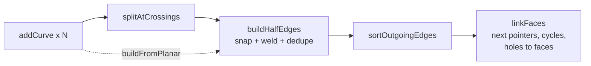
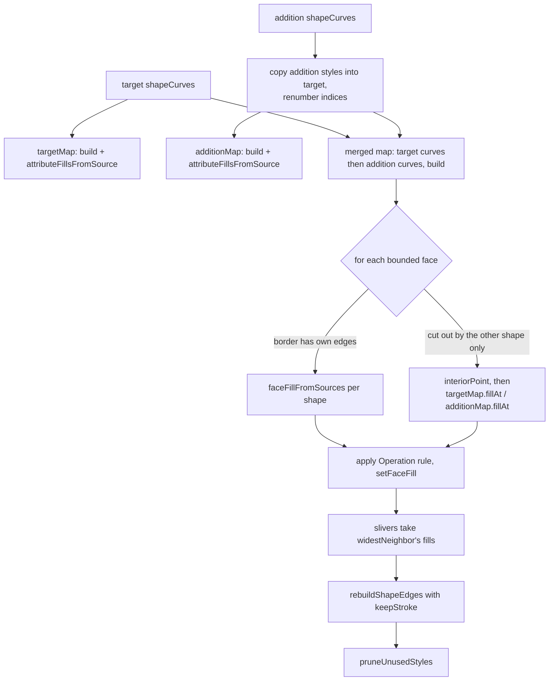

# Vector geometry in Phoenix

This document explains how Phoenix represents vector artwork, how it turns edges
into filled regions, how merge drawing and the boolean operations work, and how
curves are fitted, converted and morphed. It is written for a developer who has
to fix a fill or merge bug and needs the model in their head first.

Related documents:

- [fla-format.md](fla-format.md): the `edges` attribute grammar (`!`, `|`, `[`,
  `S`/`FS`/`LS` selectors, hex fixed-point coordinates) and the rest of the XML.
- [swf.md](swf.md): SWF import and export, shape records, morph shapes in SWF.
- [architecture.md](architecture.md): where `src/data`, `src/edit`, `src/geom`
  and `src/gui` sit in the application as a whole.
- [importers.md](importers.md): SVG, PDF/AI, PostScript and PSD import, which
  produce cubic artwork.

Code map for this topic:

| Area | Files |
| --- | --- |
| Data model | [src/data/shape.h](../src/data/shape.h), [edge.h](../src/data/edge.h), [fill_style.h](../src/data/fill_style.h), [solid_color.h](../src/data/solid_color.h), [linear_gradient.h](../src/data/linear_gradient.h), [radial_gradient.h](../src/data/radial_gradient.h), [bitmap_fill.h](../src/data/bitmap_fill.h), [stroke_style.h](../src/data/stroke_style.h), [morph_shape.h](../src/data/morph_shape.h) |
| Geometry kernel (Qt free) | [src/geom/curve.h](../src/geom/curve.h), [intersect.h](../src/geom/intersect.h), [planar_map.h](../src/geom/planar_map.h), [shape_geometry.h](../src/geom/shape_geometry.h), [fill_attribution.h](../src/geom/fill_attribution.h), [fill_tracing.h](../src/geom/fill_tracing.h) |
| Editing | [src/edit/shape_merge.h](../src/edit/shape_merge.h), [region_split.h](../src/edit/region_split.h), [region_fill.h](../src/edit/region_fill.h), [combine_objects.h](../src/edit/combine_objects.h), [shape_transform.h](../src/edit/shape_transform.h), [editable_path.h](../src/edit/editable_path.h), [curve_fit.h](../src/edit/curve_fit.h), [path_tidy.h](../src/edit/path_tidy.h), [shape_recognition.h](../src/edit/shape_recognition.h), [path_bend.h](../src/edit/path_bend.h), [shape_tween.h](../src/edit/shape_tween.h), [trace_bitmap.h](../src/edit/trace_bitmap.h) |
| GUI and rendering | [src/gui/phoenix_view.cpp](../src/gui/phoenix_view.cpp) (`buildShapePaths`, `paintEntry`, `getFillBrush`, `getPen`, `hitTestElement`), [draw_placement.cpp](../src/gui/draw_placement.cpp), [stroke_effects.cpp](../src/gui/stroke_effects.cpp), [shape_outline.cpp](../src/gui/shape_outline.cpp), [fill_offset.cpp](../src/gui/fill_offset.cpp), [lines_to_fills.cpp](../src/gui/lines_to_fills.cpp), [paint_tools.cpp](../src/gui/paint_tools.cpp), [brush_tools.cpp](../src/gui/brush_tools.cpp), [swf_export.cpp](../src/gui/swf_export.cpp) |
| Writing | [src/writer/edge_writer.cpp](../src/writer/edge_writer.cpp), [xfl_writer.cpp](../src/writer/xfl_writer.cpp) (`writeShape` region) |

---

## 1. The shape model

### 1.1 Shape, Edge, Path, PathSegment

A `fla::Shape` ([src/data/shape.h](../src/data/shape.h)) is a bag of edges plus
two style tables:

```
Shape
 |- fills    : vector<FillStyle*>      (ownership)
 |- fillsMap : map<int, FillStyle*>    (index as the file numbers it -> style)
 |- strokes / strokesMap               (same, for StrokeStyle)
 |- edges    : vector<Edge*>
 |    Edge
 |     |- fillStyle0, fillStyle1, strokeStyle   (indices into the maps, -1 = none)
 |     |- data        (the original `edges` text, see 1.6)
 |     |- paths : vector<Path*>
 |          Path
 |           |- styleIndex, fillStyleIndex, lineStyleIndex  (-1 = not set)
 |           |- segments : vector<PathSegment*>
 |                PathSegment { command: Move | Line | Quad | Cubic | Close,
 |                              points: control and end points }
 |- isDrawingObject
 |- cubicEdges, readEdgeCount   (cubic records kept from the file, see 1.6)
```

Things that surprise newcomers:

- **Style indices are keys, not vector positions.** Always look styles up with
  `Shape::getFillStyleByIndex` / `getStrokeStyleByIndex`. Index `-1` means "no
  style" everywhere in memory (the parser defaults missing `fillStyle0`,
  `fillStyle1` and `strokeStyle` attributes to -1 in `parsePath` in
  [src/parser/document_parser.cpp](../src/parser/document_parser.cpp)). Code
  that treats `0` as "none" also exists (the seam pass in `buildShapePaths`
  skips indices `<= 0`; morph segments use 0 for none).
- **A path's style overrides its edge's.** `Path::fillStyleIndex` replaces the
  edge's `fillStyle1` and `Path::lineStyleIndex` replaces its `strokeStyle`;
  there is no per-path override of `fillStyle0`. Every consumer repeats this rule
  (`shapeCurves`, `traceFills`, the stroke pass of `buildShapePaths`,
  `pruneUnusedStyles`). If you add a consumer, repeat it too.
- **One `Edge` can hold several paths, and one path several segments.** After a
  merge, though, Phoenix writes one edge per piece with one path of one segment
  (`rebuildShapeEdges`), so merged artwork has many small edges.
- **Segments are relative to the previous end point.** `Line` has one point,
  `Quad` has control and end, `Cubic` has two controls and end. `Close` returns
  to the subpath start; the FLA text has no close command (the writer drops it,
  see `EdgeWriter::writePath`) and a closed path simply ends where it began.
- `Point` ([src/data/point.h](../src/data/point.h)) carries two `std::string`
  members besides `x` and `y`. Building `Point`s in hot loops is expensive for
  that reason; `Curve` evaluation in [src/geom/curve.cpp](../src/geom/curve.cpp)
  works one axis at a time to avoid it.

### 1.2 Which side is fillStyle0 and which is fillStyle1

This is the most important convention in the code, and the one most often
confused. **Coordinates are y down.** For a path walked in the direction it is
written:

```
          on screen (y down)

    fillStyle0  (left on screen)
   ------------------------------>   direction the path is written
    fillStyle1  (right on screen)
```

A closed loop written clockwise on screen therefore has `fillStyle1` inside.
The Rectangle and Oval tools rely on this
(`PrimitiveTool::createRectangleShape` traces "clockwise on screen ... so the
fill lands on the same side" and sets only `fillStyle1`), and so does the test
helper in [tests/test_fill_tracing.cpp](../tests/test_fill_tracing.cpp), whose
square `!0 0|2000 0|2000 2000|0 2000|0 0` carries `fillStyle1 = 1`.

The same loop has a **positive** signed area by the shoelace sum
`sum(x_i * y_(i+1) - x_(i+1) * y_i)`. The geometry kernel speaks in that
mathematical frame and calls the side "left": `HalfEdge::leftFill` in
[planar_map.h](../src/geom/planar_map.h) is `fillStyle1` for a half-edge running
the way the edge was written, and `rebuildShapeEdges` writes
`fillStyle1 = leftFill`, `fillStyle0 = rightFill`. "Left" in `src/geom` and
"right on screen" in [fill_tracing.h](../src/geom/fill_tracing.h) are the same
side. The comment on `HalfEdge::leftFill` notes the convention was settled
empirically; the corpus test `real_shapes_agree_on_which_side_a_fill_is` in
[tests/test_shape_geometry.cpp](../tests/test_shape_geometry.cpp) counts which
reading makes real files self-consistent (it needs `PHOENIX_FLA_CORPUS`).

When you build edges from a polygon, decide the side from the signed area, as
`fla::outline::shapeFromLoops` ([src/gui/shape_outline.cpp](../src/gui/shape_outline.cpp))
and the SVG importer ([src/edit/vector_import.cpp](../src/edit/vector_import.cpp))
do: a positive loop that is filled inside gets `fillStyle1`, a negative one
`fillStyle0`, and a hole takes the other side.

### 1.3 Coordinates and precision

- In memory, coordinates are `double` pixels. The FLA stores twips (1/20 pixel).
- `EdgeWriter` ([src/writer/edge_writer.h](../src/writer/edge_writer.h)) writes
  coordinates in twips with 8 bits of fraction (1/256 twip), whole twips in
  decimal and finer values in the `#hex.hex` form, within a signed 24-bit
  integer range (`kIntegerRange`). Morph coordinates use their own hex format
  (`formatMorphCoordinate`).
- The planar map snaps every vertex to the twip grid
  (`PlanarMap::kTwip = 1.0 / 20.0`, `snapToTwips`). That makes vertex welding an
  exact hash lookup (`_vertexLookup`) instead of a distance search.
- Tracing and stroke chaining compare points to the twip
  (`sameTwip` in [fill_tracing.cpp](../src/geom/fill_tracing.cpp), `pointsMatch`
  in `buildShapePaths`).

### 1.4 Fill styles

`FillStyle::Type` is `SolidColor`, `LinearGradient`, `RadialGradient` or
`BitmapFill`. Every fill has a `Transform` matrix; gradients add `entries`
(ratio plus RGBA), `spreadMethod` and `interpolationMethod` (empty means pad and
RGB). `RadialGradient::focalPointRatio` (-1 to 1) gives a focal gradient; there
is no separate focal type. `BitmapFill` names a library bitmap
(`bitmapPath`), its matrix maps bitmap pixels to twips (an unscaled bitmap has
scale 20), and `bitmapIsClipped` means "shown once" instead of tiled. Section 6
describes how each becomes a `QBrush`.

### 1.5 Stroke styles

`StrokeStyle` ([src/data/stroke_style.h](../src/data/stroke_style.h)) is
abstract; the concrete classes are `SolidStroke`, `DashedStroke`,
`DottedStroke`, `RaggedStroke`, `StippleStroke`, `HatchedStroke` and
`PaintBrushStroke`. Every stroke paints with a `fill` (a `FillStyle*`, so
strokes can be gradients or bitmaps). Fields:

- `weight` in pixels; `solidStyle == "hairline"` (`isHairline()`) for a
  one-device-pixel line.
- `scaleMode` (`"normal"`, `"none"` and the other values as the file names
  them), `caps` (`"none"`, `"round"`, `"square"`), `joints` (`"miter"`,
  `"round"`, `"bevel"`), `miterLimit`, `pixelHinting`. Empty caps/joints mean
  the format default, round.
- `dash1`, `dash2` (dashed), `dotSpace` (dotted), and `styleAttributes` for
  ragged, stipple and hatched settings kept as the file spells them.
- `widthProfile`: a variable-width stroke, a list of `WidthMarker`
  (`position` 0..1 along the stroke, `left` and `right` reach as fractions of the
  weight, `corner`). Read from the `VariablePointWidth` child; other unknown
  children are kept verbatim in `extraChildren`.
- `paintBrushDefinition`: index into the document's paint brush definitions for
  art and pattern brushes ([src/edit/paint_brushes.h](../src/edit/paint_brushes.h)).
- Phoenix's own symbol-based brushes are found through the `phoenixBrush`
  extra attribute (`PhoenixView::brushOf`).

Strokes are geometry-free: the edge's path is the center line. All width, cap,
join and brush handling happens at draw time (section 6), except when a command
explicitly converts strokes to fills (section 4.3).

### 1.6 Quadratics, cubics and the file

The FLA `edges` attribute stores quadratics. FLA files written by drawing tools
also keep `Edge` elements with a `cubics` attribute next to the quadratic ones,
for re-editing. Phoenix handles both directions:

- **Reading:** `parseEdges` stores `cubics` edges as raw XML in
  `Shape::cubicEdges`, each with the number of edges before it, and records
  `readEdgeCount`. The quadratic `Edge` keeps its original text in `Edge::data`.
- **In memory:** tools freely create `Cubic` segments (pen, pencil, brush,
  rectangle corners, ovals, importers, merges). Raising a quadratic to a cubic is
  exact (`Curve::quadratic`, `quadToCubic` in
  [editable_path.cpp](../src/edit/editable_path.cpp)): controls at 2/3 of the
  way from each end to the quadratic control.
- **Writing:** `XFLWriter` writes `Edge::data` verbatim when it is non-empty,
  and otherwise regenerates with `EdgeWriter::writeEdgeAsAnimate`, which
  replaces each cubic by quadratics (`cubicToQuads`: recursive halving until the
  midpoint-quadratic error estimate `sqrt(3)/36 * |p3 - 3p2 + 3p1 - p0|` is at
  most 0.025 px, half a twip, or depth 8) and emits a matching `cubics` record.
  The kept `cubicEdges` are written back only while `Shape::cubicsStillMatch()`
  holds (same edge count as read and every edge still has its `data`).

**Pitfall:** because the writer prefers `Edge::data`, any code that moves points
in place must clear `edge->data`, as `bakeTransform`, `warpShape` and
`prepareForWarp` in [shape_transform.cpp](../src/edit/shape_transform.cpp) do.
Forgetting this saves the old geometry while the screen shows the new one.
Edges built fresh (`rebuildShapeEdges`, `EditablePath::applyTo` on a new edge)
start with empty `data`.

### 1.7 Merge shapes, drawing objects, groups, primitives

- A plain `Shape` is **merge artwork**: drawing over it cuts and replaces it
  (section 3).
- `Shape::isDrawingObject` marks an object-drawing shape. It never merges in
  either direction (`shapesUnder` in [draw_placement.cpp](../src/gui/draw_placement.cpp)
  skips it, and `commitPendingMerge` refuses it). Break Apart turns it into merge
  artwork through `SetDrawingObjectCommand`. Combine Objects
  ([combine_objects.cpp](../src/edit/combine_objects.cpp)) works on drawing
  objects.
- `Group` ([src/data/group.h](../src/data/group.h)) is a list of member elements.
  Merging only considers shapes that are direct elements of the frame and not
  outside the group being edited (`view.outsideGroup`).
- `RectanglePrimitive` and `OvalPrimitive` are separate element types holding a
  rectangle, corner radii (`topLeftRadius`... in pixels, negative scoops
  inward), or start/end angle and `innerRadius` (percent), plus one fill and one
  stroke. They are not edges: `roundedRectanglePath` and `ovalPrimitivePath` in
  [phoenix_view.cpp](../src/gui/phoenix_view.cpp) build a `QPainterPath`
  directly (angles in the FLA run clockwise from three o'clock, Qt's arcs the
  other way, hence the negated angles). The non-primitive Rectangle and Oval
  tools instead build a merge `Shape`: four lines, or lines plus four cubic
  quarter arcs for rounded corners, and an oval as four cubics with
  `kappa = 0.5522847498` (`createRectangleShape`, `createOvalShape` in
  [primitive_tool.cpp](../src/gui/primitive_tool.cpp)).

---

## 2. The geometry kernel

Everything in [src/geom](../src/geom) is free of Qt and unit tested on its own.

### 2.1 Curve

`fla::Curve` ([curve.h](../src/geom/curve.h)) is the kernel's only curve type:
a line or a cubic, always four control points. A line keeps its inner controls
at 1/3 and 2/3 of the chord, so cubic formulas work unchanged; `isLine()` tells
them apart. Quadratics are raised on entry, so the kernel has one curved case.

| Method | Notes |
| --- | --- |
| `pointAt`, `tangentAt` | de Casteljau per axis; tangent is the unnormalized derivative, zero at a cusp |
| `split`, `subcurve` | de Casteljau; splitting a line gives lines |
| `controlBounds` | box of the control polygon, always contains the curve |
| `flatness` | max distance of the inner controls from the chord **segment** (not the infinite line), so a control past an end counts as a bulge |
| `extremaParameters` | t in (0,1) where x or y turns; between them the curve is monotone in both axes |
| `horizontalRayCrossings` | exact ray count: split at y extrema, bisect each monotone run (48 steps), count a run when the ray's y is in (low, high] so a vertex is counted once |
| `chordLength`, `controlPolygonLength` | the latter is zero only for a curve collapsed to a point; a closed loop has zero chord but non-zero polygon |

### 2.2 Intersections

`intersectCurves(a, b, tolerance = 1/40)` in
[intersect.cpp](../src/geom/intersect.cpp):

1. Two lines: solved directly (`intersectSegments`). Parallel and collinear
   pairs report nothing; the parallel test is relative to the segment lengths
   (`|cross| <= max(1e-12, |r||s| * 1e-10)`).
2. Otherwise recursive subdivision (`searchMapped`): if the control boxes
   (grown by the tolerance) miss, stop; if both pieces are flatter than the
   tolerance, or depth reaches 34, solve them as segments; else halve the longer
   parameter range. Hits within `tolerance` of an existing hit are merged.
   More than 1024 hits aborts (an overlap being chased).
3. Results are sorted by `t1`.

Overlapping curves report only the ends of the overlap, and only if they cross
there; T-junctions and collinear overlaps are handled by the planar map's
`addTouch`, not here.

`selfIntersections` cuts the curve at its x/y extrema, so each piece cannot
cross itself, then runs the pair search between pieces, discarding the shared
joins and a closed curve's coincident ends. Halving at the midpoint alone missed
loops lying in one half, which `self_intersections_are_found_wherever_the_loop_lies`
in [tests/test_geometry.cpp](../tests/test_geometry.cpp) guards.

### 2.3 The planar map

`PlanarMap` ([planar_map.h](../src/geom/planar_map.h),
[planar_map.cpp](../src/geom/planar_map.cpp)) is a doubly connected edge list
(DCEL) built from curves. It is the heart of merging, selection by region,
paint bucket and boolean operations.

```
MapVertex  { position (twip-snapped), outgoing half-edges sorted by angle }
HalfEdge   { from, to, twin, next, face, curve (oriented from->to),
             source (input curve index), forward (same direction as input),
             t0, t1 (stretch of the input curve), leftFill }
MapFace    { halfEdge (outer boundary), holes, unbounded, area, fillStyle }
```

Usage: `addCurve(curve, source)` for each input, then `build()` (finds
crossings) or `buildFromPlanar()` (inputs already meet only at their ends, as a
stored shape does: much faster, no crossing search).



**splitAtCrossings.** Finds candidate pairs with a sweep over control boxes
sorted by left edge, then for each curve collects cuts from:

- its self-intersections;
- `intersectCurves` with each partner, the same point given to both curves;
- `addTouch`: an endpoint of one curve lying on the other (within
  `touch = max(tolerance, kTwip / 2)`) but clear of its ends cuts it there,
  which splits T-junctions and collinear overlaps;
- a **snap-rounding pass** (`passThrough`): every cut becomes a twip-grid vertex,
  which can move it most of a twip; a curve passing through that grid cell
  without being cut there would end up on the wrong side of the welded vertex,
  making edges cross and faces merge. So any curve passing within half a twip of
  another curve's cut cell is cut at that cell too.

Each piece's ends are pinned to the exact cut point so neighbors weld to one
vertex. Cuts closer than 1e-9 in t are dropped.

**buildHalfEdges.** Snaps both ends to twips and gets vertices by hash. Then:

- A piece whose ends weld to one vertex is dropped unless it reaches more than a
  twip from that vertex and its control polygon is at least half a twip
  (`kMinimumPieceLength`); a real loop is kept.
- **Duplicate edges** (same vertex pair, midpoints within a twip) are kept once.
  The later source claims the edge, so the newer drawing's stroke shows along a
  shared edge; `forward`, `t0`, `t1` follow the new source.
- Two half-edges are created per piece, the reverse one with reversed controls.

**sortOutgoingEdges.** At vertices with three or more edges, edges are sorted by
`atan2` of where each first crosses a small circle (half the shortest chord at
the vertex, at least half a twip), not by the tangent: a pen handle pulled onto
its anchor has no tangent, and curves tangent at the vertex are told apart a
little way out.

**linkFaces.** For each half-edge `e` arriving at vertex `v`, `e.next` is the
outgoing edge just before `twin(e)` in `v`'s sorted order:

```
          outgoing[previous] = e.next
                 \
                  \
   e  --------->   v  -------> outgoing[position] = twin(e) (reversed)
```

Following `next` gives closed cycles. Cycles with positive signed area
(`signedAreaContribution`, exact for cubics by 3-point Gauss-Legendre) are
bounded faces. Non-positive cycles are boundaries seen from outside: each is
assigned as a hole to the smallest positive cycle containing a sample point
taken a quarter twip off its first edge (`sampleOutside`), or to the single
unbounded face. Containment tests use exact ray crossings (`cycleContains`,
even-odd), never sampled polygons; a sampled outline sags inside a curve by
more than the quarter-twip step.

Queries:

- `faceAt(point)`, `fillAt(point)`: first bounded face containing the point
  (faces do not overlap). `-1` outside everything.
- `interiorPoint(face)`: flatten the boundary and holes to 1/16 twip, scan nine
  horizontal lines kept off the twip grid, take the middle of the widest
  nonzero-winding span that the exact `faceContains` confirms; failing that,
  step off each boundary edge by 1/4, 1 and 4 twips. This is what decides fills
  for faces that no source edge borders, so a bad interior point paints a face
  wrong.
- `isSliver(face, width = kTwip)`: `2 * area / perimeter < width`.
  `widestNeighbor(face)` is the face across the longest shared boundary.
- `setFaceFill(face, fill)` sets the face's fill and the `leftFill` of every
  half-edge bordering it.

### 2.4 From shapes to curves and back

[shape_geometry.cpp](../src/geom/shape_geometry.cpp):

- `shapeCurves(shape)` flattens every edge's paths into `ShapeCurve`s (curve,
  `edgeIndex`, `fillStyle0`, `fillStyle1`, `strokeStyle`), applying the path
  overrides from 1.1 and turning `Close` into a line back to the subpath start.
- `attributeFillsFromSource(map, sources)` paints each face by reading its own
  border: a half-edge with `forward == true` reports its source's `fillStyle1`,
  a reversed one `fillStyle0`. Disagreements are outvoted by length
  (`readFaceFill`), ignoring half-edges with the face on both sides.
- `faceFillFromSources(map, face, sources, first, last, fill)` does the same but
  only counts sources in `[first, last)`, so a merged map can ask "what did the
  target paint here" and "what did the addition paint here" separately. It
  returns false when none of those sources border the face.
- `rebuildShapeEdges(shape, map, sources, keepStroke, strokeFor)` replaces the
  shape's edges with the map's. Per forward half-edge: left fill, right fill
  (twin's left), stroke from the source (optionally overridden by `strokeFor` or
  removed by `keepStroke`). **An edge with the same fill on both sides and no
  stroke is dropped**: that is how seams vanish. Then runs of pieces are joined
  back together:
  - `continues`: the next stretch of the same source (`t0 == previous t1`), or
    collinear lines heading the same way; joined exactly
    (`subcurve(first.t0, last.t1)`).
  - `joinsSmoothly`: different sources, different original edges, tangent
    within about three degrees (`|cross| <= 0.05`); joined only if
    `joinCurves` refits them as one cubic within half a twip.
  - Only through vertices where exactly one other drawn edge leaves
    (`onlyOtherDrawn`). A closed run also tries to join across its start.

  Output edges each hold one path of `Move` plus one `Line` or `Cubic`.
- `joinCurves(pieces, tolerance, joined)` is a Schneider-style fit with fixed
  end points and end directions, parameters initialized from the speed ratios at
  the joints (exact for pieces cut from one cubic) or chord length, then
  least-squares handle lengths and Newton reparameterization for up to 32 passes.

---

## 3. Filling: from edges to painted regions

### 3.1 The model has no fill rule

A shape does not store "even-odd" or "nonzero". Each edge says what lies on each
of its sides, and a fill region is whatever those sides enclose. Rendering
therefore has to **assemble closed outlines per fill** from edge sides. There
are two implementations.

### 3.2 traceFills (the default renderer path)

`traceFills(shape)` in [fill_tracing.cpp](../src/geom/fill_tracing.cpp) returns,
for each fill index, a list of `TracedLoop`s, each a list of `TracedLeg`
(a `Path*` walked forward or reversed) with its fill on the right on screen.

1. For every visible path: if `fill1 != -1`, add it forward under `fill1`; if
   `fill0 != -1`, add it reversed under `fill0`. A path with the same fill on
   both sides goes in both ways, except a closed loop with one fill inside and
   out.
2. Per fill with at most two directed paths: join first come first served.
3. Otherwise: directed paths already closed on themselves are loops. The rest
   are indexed by start point (by twip and by pixel), and chained. At each
   junction the candidates are paths starting at **exactly** the current end
   (to the twip); only if there are none, paths starting within half a pixel.
   Among candidates the one turning **furthest right** (`rightTurn`, a straight
   reversal counts as the sharpest left) is taken, which keeps the walk on one
   region's boundary.
4. A loop that cannot close is returned open (`closed = false`). The renderer
   still draws it, which is how slightly broken files have always looked.

```
   fill 1 on the right of every directed leg; at the junction J
   the walk takes the sharpest right turn, staying in region 1:

        a --->--- J --->--- b        legs leaving J: (1) down, (2) straight
                  |
                  v (1) chosen       (2) would wander into the neighbor
```

### 3.3 fillOutlinesFromMap (opt-in)

`fillOutlinesFromMap` in [shape_geometry.cpp](../src/geom/shape_geometry.cpp)
builds a `PlanarMap` with `buildFromPlanar`, attributes fills from sources, and
**verifies** that every half-edge's face carries exactly the fill its source
records on that side. Any mismatch (outlines that do not quite close, crossing
edges, inconsistent fill sides), hidden edges or paths, or more than 20000
curves makes it return false. Slivers take their widest neighbor's fill. Each
face is emitted as its outer cycle plus holes, using the stretch of the
**original** curve (`subcurve(t0, t1)`), not the twip-welded copy, so stored
coordinates draw exactly.

It is used only when the environment variable `PHOENIX_RENDER_FROM_MAP=1` is
set (`renderFillsFromMap()` in [phoenix_view.cpp](../src/gui/phoenix_view.cpp));
otherwise, and whenever it returns false, `traceFills` is used. The tests
`fills_drawn_from_the_map_match_the_traced_fills` and
`real_shapes_drawn_from_the_map_match_the_traced_fills` compare the two.

### 3.4 Fill rule at render time

Both paths produce, per fill index, one compound `QPainterPath` with
`Qt::WindingFill`. Outer boundaries and holes run opposite ways (fill on the
right on screen), so a hole's winding cancels the outer boundary's. Because loops
come from edge sides, not from the order edges are listed, nonzero is safe
here; it would be wrong to switch to `Qt::OddEvenFill` to "fix" an overlap,
since that would hide an attribution bug rather than fix it.

Elsewhere in the kernel, containment by ray crossings is even-odd
(`outlineContains`, `cycleContains`); `interiorPoint` uses winding on the
flattened face boundary, where holes run the other way.

### 3.5 Debugging a fill bug

1. Check the side convention (1.2) on the offending edges: a loop written
   counterclockwise on screen with `fillStyle1` set fills its outside.
2. Check for endpoints that miss by more than a twip: `traceFills` falls back
   to the half-pixel pass, and beyond that leaves an open loop.
3. Run with `PHOENIX_RENDER_FROM_MAP=1`: if the map path rejects the shape
   (falls back silently), the shape's sides are inconsistent; if both paths draw
   the same wrong thing, the stored data is wrong, not the renderer.
4. If the shape came out of a merge, suspect slivers and the interior point
   (sections 3.6 and 7).

### 3.6 Merge drawing

Merge drawing is `ShapeMerger::combine` in
[shape_merge.cpp](../src/edit/shape_merge.cpp). The four public entry points
are thin wrappers choosing an `Operation`:

| Call | Operation | Face fill rule (A = addition's fill, T = target's) |
| --- | --- | --- |
| `merge` | Paint | `A != -1 ? A : T` |
| `subtract` | Erase | `A != -1 ? -1 : T` |
| `eraseStrokes` | EraseStrokes | `T` |
| `clip` | Keep | `A != -1 ? T : -1` |

An addition outline with no fill (`A == -1` inside it) still cuts faces
without repainting them, which is how a line drawn across a fill divides it.



Details that matter when debugging:

- **Indices.** Target curves come first in `combined`, so `source <
  targetCurveCount` means "from the target". Addition styles are cloned into the
  target under fresh indices (`nextIndex` = highest + 1) before anything else.
  `pruneUnusedStyles` afterwards deletes unused styles and renumbers the rest
  from 1 in their old order.
- **Strokes (`keepStroke`).** Addition strokes stay when painting and go when
  erasing. A target stroke is buried (removed) when the addition paints both of
  its sides, unless `MergeOptions::keepStrokes` (Paint Fills, Paint Behind,
  Erase Fills brush and eraser modes). EraseStrokes removes target strokes with
  the cutter on both sides. Keep retains target strokes the cutter covers on
  either side.
- **Same coordinate space.** Merging compares raw edge coordinates. Every
  caller first runs `bakeTransform` on both shapes
  ([shape_transform.cpp](../src/edit/shape_transform.cpp)); the test
  `merging_ignores_a_transform_that_was_not_baked` documents what happens if
  not.

#### The drawing workflow

[draw_placement.cpp](../src/gui/draw_placement.cpp):

1. `placeDrawnElement` adds the new shape (one undo macro). In object drawing
   mode that is all. Otherwise, for every merge shape below it whose view
   bounds intersect (`shapesUnder`, nearest first), it bakes the target's
   transform, snapshots it, and pushes a `SubtractShapeCommand`: the drawing
   immediately cuts its hole, while still floating above as its own selected
   shape (`view.setPendingMerge`).
2. On deselect, `commitPendingMerge` pushes a `MergeShapeCommand` into the
   nearest shape below and `SubtractShapeCommand`s into the rest, then removes
   the floating drawing. If nothing happened in between, the merge is applied to
   the **uncut** snapshot instead of to the cut target (`base` argument of
   `MergeShapeCommand`): the hole's outline is a welded, refitted copy of the
   drawing's own, and merging a curve into its own near-duplicate is the hardest
   case for the map (see `a_merge_from_the_uncut_artwork_undoes_to_the_cut`).
3. Commands run the merge once in their constructor and only swap snapshots in
   `undo`/`redo` (`MergeShapeCommand`), so undo cannot drift.

### 3.7 Erasing

The eraser ([brush_tools.cpp](../src/gui/brush_tools.cpp), `EraserTool`) builds
a cutter shape from its stroke, optionally restricted (Inside mode keeps only
the region the pass began in), then pushes per target either
`EraseStrokesCommand` (Lines mode) or `SubtractShapeCommand` with
`keepStrokes = mode != Normal`. The faucet removes one picked fill or stroke via
`RegionSplitter::withFaceFill(face, -1)` / `withStroke(pick, -1)`.

### 3.8 Boolean operations on drawing objects

`combine::apply` ([combine_objects.cpp](../src/edit/combine_objects.cpp)):

- **Union:** bake the bottom shape, then `merge` each higher one in order.
- **Intersect:** start from the topmost, `clip` it by each other shape.
- **Punch:** the topmost, moved into each lower shape's space (`intoSpaceOf`
  with the inverse matrix via `warpShape`), is `subtract`ed from it.
- **Crop:** the same with `clip`.

The results are drawing objects again (`isDrawingObject = true` for Union and
Intersect).

### 3.9 Region selection, paint bucket, ink bottle

`RegionSplitter` ([region_split.cpp](../src/edit/region_split.cpp)) arranges one
shape (with `build`) and answers region questions:

- `pickAt(point, tolerance, extended)`: a stroked forward half-edge within
  tolerance wins (strokes draw on top); otherwise the face under the point if it
  has a fill. A double-click (`extended`) adds the fill's boundary strokes, or
  follows a stroke through vertices with exactly two pieces
  (`connectedStrokes`).
- `split(pick, piece, remainder)`: the piece is the face's boundary as edges with
  `fillStyle1 = fill` (the face is on each half-edge's left); the remainder is the
  same map with that face emptied, rebuilt. This is how the arrow tool lifts a
  fill out of merge artwork (`PhoenixView::selectRegionAt`).
- With `cutters` (closed outlines carrying no style), faces on either side of a
  marquee or lasso become separate faces. Faces bordered only by cutter pieces
  get their fill from a separate, cutter-free map of the shape via an interior
  point. Then `facesWhere`/`strokesWhere` plus `splitSet` lift what is inside.
- `withFaceFill`, `withFacesFill`: paint bucket results. `withStroke`: the ink
  bottle; it uses `rebuildShapeEdges`' `strokeFor` override so only the picked
  pieces change.

The paint bucket (`PaintBucketTool::pressRegion` in
[paint_tools.cpp](../src/gui/paint_tools.cpp)) finds the face under the click.
If there is none and a gap size is set, `gapJoins(gap)` proposes straight joins:
each loose end (a vertex with one outgoing half-edge, necessarily a stroke end)
to the nearest other loose end within the gap, else to the nearest point on
another piece. The shape is re-arranged with those joins as cutters, so they
become fill boundaries without strokes. Gap sizes are 3, 8 or 20 screen pixels
divided by the zoom (`gapFor`). Fill All Regions repaints, one at a time, every
other region that had the clicked region's old fill. Scribble, lasso and Fill
Across Frames live in [region_fill.cpp](../src/edit/region_fill.cpp)
(`facesAlong`, `facesInside`, region footprints matched by centroid and area).

### 3.10 Trace Bitmap

`traceBitmap` ([trace_bitmap.cpp](../src/edit/trace_bitmap.cpp)) groups pixels
of similar color into areas, folds small areas into the neighbor they share the
most edge with, and emits **one edge per boundary chain between two areas**,
with `fillStyle0` the area on the left and `fillStyle1` the area on the right
(page y down), so areas meet without gaps. Chains are simplified within the
chosen curve fit tolerance.

---

## 4. Curves: input, conversion, offsetting

### 4.1 Anchors and EditablePath

Tools do not edit `PathSegment`s directly. `EditablePath`
([editable_path.h](../src/edit/editable_path.h)) is a list of `Anchor`s, each
with absolute `inHandle` and `outHandle` and a `smooth` flag. A handle within
1e-6 of its anchor counts as absent.

- `fromPath` raises quadratics to cubics, treats a path ending on its start as
  closed (dropping the duplicate anchor), and marks anchors with both handles
  smooth.
- `applyTo(edge, pathIndex)` replaces one path: a `Line` when neither side
  curves, else a `Cubic`; a closed path gets a final segment back to the first
  anchor ("ending on the first point is what tells the fill reconstruction the
  outline encloses an area").
- `splitSegment`, `removeAnchor` (refits through the gap), `toggleAnchorSmooth`,
  `closestPoint`, `reversed`, `transformed`.

The subselection tool ([subselection_tool.h](../src/gui/subselection_tool.h))
shows and drags anchors. Because a merged shape is one edge per piece, it grabs
**every anchor at the same position** when moving one, or the outline would
tear; deleting a shared corner joins the two pieces and refits.

### 4.2 Freehand input

- **Pencil** ([pencil_tool.cpp](../src/gui/pencil_tool.cpp)): points are
  snapped to drawing aids, optionally stabilized (`BrushStroke::stabilized`),
  then fitted by `CurveFit::fit`. Tolerance is in screen pixels divided by zoom:
  Ink mode 0.5, otherwise 0.25 + 4.75 * smoothing/100. Straighten mode fits
  straight segments and then `tidyStraightenedStroke` connects near ends and
  replaces recognizable rectangles and ovals ([path_tidy.h](../src/edit/path_tidy.h),
  [shape_recognition.h](../src/edit/shape_recognition.h)).
- **CurveFit** ([curve_fit.cpp](../src/edit/curve_fit.cpp)) is Schneider's
  algorithm: drop points closer than `minimumSpacing`, detect corners where the
  direction turns more than `cornerAngle` over a window, fit each run between
  corners with one cubic by least squares (end points and end tangents fixed),
  improve by Newton-Raphson reparameterization, split at the worst point when
  over tolerance (the split shares a tangent so halves meet smoothly). Negative
  handle lengths fall back to a third of the chord; handles are capped at four
  chords; at maximum depth the raw points are kept as a polyline. Straighten
  mode uses Ramer-Douglas-Peucker instead. A cubic whose handles lie on the chord
  is written as a line.
- **Smooth / Straighten / Optimize** commands ([path_tidy.h](../src/edit/path_tidy.h)):
  `smoothPath` pulls handles toward Catmull-Rom tangents by an amount,
  `straightenPath` is RDP on samples, `optimizePath` refits samples with the
  pencil's fitter.
- **Bending** with the arrow ([path_bend.h](../src/edit/path_bend.h)) spreads the
  drag along the smooth run either side of the grab, up to a corner, the path end,
  a quarter turn or half a loop, with weights easing off by distance, so fitted
  outlines with short segments do not crease.

### 4.3 Brushes, offsets, lines to fills

Brush strokes are **fills**, not strokes. `BrushStroke::dabs` turns samples into
tip imprints, `sweep` gives the convex hull of each neighboring pair of dabs,
and `sweptOutline` in [brush_tools.cpp](../src/gui/brush_tools.cpp) unions them
as a `QPainterPath` with `simplified()`. The resolved outline is a dense polygon,
so each loop is refitted with `CurveFit` into a few cubics; the hole test is
nesting parity among the loops and the side is chosen from the signed area
(`outlineShape`).

The same "Qt area operation, then refit" pattern is reused:

- `fla::outline::shapeFromOutline` / `shapeFromLoops`
  ([shape_outline.cpp](../src/gui/shape_outline.cpp)): any `QPainterPath` area
  becomes a merge shape. Loops are densified to points every 2 units first so the
  corner detector sees straight runs, then fitted with tolerance 0.3. The largest
  loop's orientation decides which way "outside in" runs.
- **Convert Lines to Fills** (`convertLinesToFills` in
  [lines_to_fills.cpp](../src/gui/lines_to_fills.cpp)): per stroke style,
  `QPainterPathStroker` with the stroke's width, caps, joins and miter limit,
  `simplified()` under winding fill, `shapeFromOutline`, then the strokes are
  removed and the new fills merged with `ShapeMerger::merge`.
- **Expand Fill / Soften Fill Edges** ([fill_offset.cpp](../src/gui/fill_offset.cpp)):
  the regions come from `PhoenixView::fillRegions`, the same paths the renderer
  draws. The offset boundary is found by stroking the outline at twice the
  distance with round joins and keeping the ring loops outside the region
  (expand) or inside it, reversed (inset). The code avoids Qt's area subtraction
  on purpose (the comment in `boundaryAt` says it returned the wrong operand for
  these inputs). New fills replace the old ones by `merge` with `keepStrokes`.
  Softening adds bands with decreasing alpha for solid fills.

### 4.4 Hit testing

`PhoenixView::hitTestElement` tests a shape against its cached render entries
(`shapePaths`): strokes by stroking the center line at half the pen width plus
the pick tolerance (`isNearOutline`), paint brush strokes against their art,
fills by `QPainterPath::contains`, and a point just outside an unstroked fill
counts as its outline so the arrow can bend fill edges. Anchors beat fills and
strokes. `pickTolerance()` is a few screen pixels in document units. Region-level
picking after that is `RegionSplitter::pickAt` (3.9).

---

## 5. Shape tweens

The file stores a shape tween as a `MorphShape` on the first keyframe
([morph_shape.h](../src/data/morph_shape.h)): `MorphSegment`s, each a start
point A/B and a list of `MorphCurves` (control and anchor for A and for B,
quadratics), with `fillIndex1`/`fillIndex2`/`strokeIndex1`/`strokeIndex2`
(0 = none), plus raw `hintsXml`. Code in
[shape_tween.cpp](../src/edit/shape_tween.cpp):

- `tweenShapes(start, end, from, to)`: the first shape on each keyframe.
- `morphedShape(morph, from, to, t, ...)`: builds a temporary `Shape` at
  progress `t`. Every point is `mix(A mapped by from's transform, B mapped by
  to's transform, t)` and then brought into the drawing space. Styles come from
  the first keyframe's table, each blended with the last keyframe's style of the
  same index (`blendFills`: colors, gradients stop by stop and matrix when
  alike, otherwise a copy of A; `blendStrokes`: weight and fill). `fillIndex1`
  becomes `fillStyle0` (right of the segment) and `fillIndex2` `fillStyle1`.
  Unstyled morphs take the first fill and stroke.
- `buildMorph(from, to, parent, hints)`: when Phoenix creates or rebuilds a
  morph. `outlinesOf` chains each fill's directed outlines (fill on the left in
  the kernel's sense) and each stroke's undirected runs; outlines pair within
  groups (fill index plus orientation, so holes pair with holes; strokes by
  index), largest area or length first; unpaired ones grow from or shrink to a
  point. `pairSegment` aligns a closed pair's start (leftmost anchor of A, best
  least-squares offset on B over anchors and 48 fixed fractions), flips an open
  pair if the ends are closer crossed, cuts both at the union of their anchor
  fractions, and emits quadratics (`toQuadratic`, one per line pair, two halves
  per curved pair).
- **Shape hints** (`ShapeHint`, stored in the Phoenix attribute
  `phoenixShapeHints` as `"ax ay bx by;..."`) pair the outlines they lie on and
  pin fractions along them; hints that would fold an outline back are dropped.
- `morphSignature(from, to)` is an FNV-style hash of everything `buildMorph`
  reads (never zero). `ensureMorph(start, end)` combines it with the hints and
  compares with `Frame::morphSignature`. A morph read from the file
  (signature 0) is adopted as is the first time; after that any change to either
  keyframe shape or the hints rebuilds it. It is called from the renderer
  (`drawShape`), the XFL writer, the document parser, frame baking and SWF
  export.

The renderer draws a morphed shape through `buildShapePaths` each frame
**without** `_pathCache` (the temporary shape is built and discarded in
`drawShape`).

---

## 6. Rendering with QPainter

`PhoenixView::buildShapePaths` ([phoenix_view.cpp](../src/gui/phoenix_view.cpp))
turns a shape into a list of `PathCacheEntry` (brush, pen, path, stroke style,
fill index, plus effect, seam, cached stroke outline and paint brush art).
`shapePaths(shape)` caches the list in `_pathCache`, a `QMap` keyed by
`const fla::Shape*`. The cache is cleared wholesale by `clearCaches()` and per
shape by `forgetShape()`; tools that edit geometry call one of them after
pushing their command. **A geometry change that skips both draws stale paths.**

Fill entries:

1. Loops from `traceFills` (or the map path, 3.3) become one compound path per
   fill index with `Qt::WindingFill`. Each leg is replayed forward or reversed
   (`addSegmentToPath` reverses quads and cubics by swapping controls).
2. Brushes (`getFillBrush`):
   - Solid: `QColor` from RGBA.
   - Linear: `QLinearGradient` from (-1638.4, 0) to (1638.4, 0), brush transform
     equal to the fill matrix with its linear part halved, so the gradient spans
     +-819.2 units of the matrix space. Spread from `spreadMethod`; linearRGB
     interpolation is handled in `addGradientStops`.
   - Radial: `QRadialGradient` radius 1638.4 at the origin, focal point at
     `focalPointRatio * radius` on x, the ratio clamped to +-0.99, same transform.
   - Bitmap: `QBrush(pixmap)` with the matrix's linear part divided by 20.
     Clipped bitmaps are padded with their edge pixels to cover the filled area so
     tiling never shows (cached in `_paddedFills`).
3. **Seams:** antialiased neighboring fills each blend with the background along
   a shared edge, leaving a faint line. For every edge with two different fills,
   the lower fill index also gets a `seamPath` stroked with a 1 px cosmetic pen
   in its own brush, only when the brush is fully opaque.

Stroke entries:

1. Pieces are grouped by stroke index and chained end to end (twip matching,
   either direction) into runs, closed when a run returns to its start. Without
   this, a merged shape (one edge per piece) would get caps at every corner and
   never joins.
2. `getPen`: hairline is a cosmetic pen of width 0; `scaleMode "none"` can be
   cosmetic too (`penForHere` adapts width per placement); caps and joins
   default to round (Qt defaults to square/bevel); dashes are in pen-width units;
   dotted is a 0.001 dash with round caps; gradient and bitmap strokes use the
   fill brush.
3. Procedural strokes (`StrokeEffects::isProcedural`: ragged, stipple, hatched,
   or any `widthProfile`) get `effectPath`, an area filled with the pen's brush
   ([stroke_effects.cpp](../src/gui/stroke_effects.cpp)). Randomness is seeded
   from the path's bounds and element count, so marks are stable between paints.
   Variable width samples the center line, evaluates `widthAt` (smoothstep
   between markers unless both are corners) and builds left and right offsets,
   two opposite loops for a closed stroke.
4. Paint brush strokes get `paintBrushArt` laid along the center line once
   (`layPaintBrushStroke`); symbol brushes draw through `drawBrushStroke`, art
   stretched or tiled along `path.length()`.

`paintEntry` then draws. Strokes at least one device pixel wide and not cosmetic
are filled from a `QPainterPathStroker` outline cached on the entry
(`strokeOutline`, remade only when the width changes); thinner ones are stroked
by Qt. Outline view draws every path as a hairline in the layer color; mask
passes fill areas in black and skip strokes. Painters are set to
`QPainter::Antialiasing`.

### Export reuse

- **SWF:** [swf_export.cpp](../src/gui/swf_export.cpp) paints through a
  `PaintRecorder` ([paint_recorder.h](../src/gui/paint_recorder.h)) that keeps
  each painted fill area (strokes and text turned into areas) with its brush.
  `swfOutline` converts each cubic into four quadratics whose control is where
  the end tangents meet (midpoint when they do not), closes every subpath, and
  shapes are deduplicated by a SHA-1 of outline and fill. So SWF output is the
  renderer's geometry, not the edges. Morph shapes and the structured movie
  writer are described in [swf.md](swf.md).
- **SVG frames:** `exportFrameSvg` paints through `QSvgGenerator`, again the
  renderer's paths.
- **FLA/XFL:** edges as described in 1.6; see [fla-format.md](fla-format.md).

---

## 7. Numerical robustness

### 7.1 Tolerances in one place

| Constant | Value | Where | Meaning |
| --- | --- | --- | --- |
| `PlanarMap::kTwip` | 1/20 px | planar_map.h | vertex grid |
| `build()` tolerance | kTwip/4 | planar_map.h | intersection flatness and dedupe |
| `touch` | max(tol, kTwip/2) | `splitAtCrossings` | T-junction reach |
| pass-through | half a twip from cell center | `passThrough` | snap-rounding extra cuts |
| `kMinimumPieceLength` | kTwip/2 | planar_map.cpp | collapsed piece |
| duplicate edge | midpoints within kTwip | `buildHalfEdges` | coincident pieces |
| sliver | 2A/P < kTwip | `isSliver` | invisible face |
| `intersectCurves` default | 1/40 px | intersect.h | flatness and merge distance |
| `kMaxDepth` | 34 | intersect.cpp | subdivision depth |
| `joinCurves` in rebuild | kTwip/2 | `rebuildShapeEdges` | refit tolerance |
| smooth join angle | `|cross| <= 0.05` | `joinsSmoothly` | about three degrees |
| trace exact / near | 1 twip / 0.5 px | fill_tracing.cpp | junction matching |
| `cubicToQuads` | 0.025 px, depth 8 | edge_writer.cpp | save precision |
| handle epsilon | 1e-6 | editable_path.cpp | handle on its anchor |
| `kLargestCoordinate` | 1e12 px | planar_map.cpp | NaN/huge guard |

### 7.2 Known pitfalls and how the code handles them

- **Near-coincident outlines.** A drawing merged back into the hole it cut has
  two copies of nearly one curve. Duplicate-edge removal, snap-rounding cuts,
  sliver folding and joining by `t0`/`t1` all exist for this case. Merging from
  the uncut snapshot (3.6) avoids it where possible. Tests:
  `merging_along_a_nearly_shared_edge_leaves_no_gap`,
  `merging_into_the_hole_a_straight_sided_drawing_cut_loses_nothing`,
  `sixteen_crossing_strokes_let_go_where_drawn_lose_nothing`,
  `radial_copies_crossing_let_go_where_drawn_lose_nothing`.
- **Welding moves vertices up to half a twip**, which can make edges cross that
  did not; the pass-through cuts prevent faces from running together.
- **Degenerate tangents** (handles on their anchors): angular sorting uses a
  circle crossing, `joinCurves` and `endDirection` fall back to the next control
  point and then the chord, tracing tangents skip zero-length legs.
- **Loops with zero chord** are not "collapsed"; collapse is decided by reach
  and control polygon length.
- **Faces with the same face on both sides of an edge** (dangling strokes) are
  ignored when voting on a face's fill (`readFaceFill`).
- **NaN and huge coordinates** are dropped by `PlanarMap::addCurve`; the writer
  maps NaN to 0 and clamps (`roundedWithin`); the tween skips non-finite curves
  (`outlinesOf`); `planar_map_leaves_out_curves_that_are_not_numbers` covers it.
- **Unbaked transforms** silently give wrong merges: always `bakeTransform`
  before combining shapes.
- **Stale `Edge::data`** after in-place edits (1.6) and **stale `_pathCache`**
  after geometry edits (6).
- **Performance:** `build()` on large shapes is expensive; stored shapes use
  `buildFromPlanar()`, the pair search uses a box sweep, `traceFills` indexes
  starts by twip and pixel (`tracing_joins_thousands_of_pieces_listed_out_of_order`),
  and the map renderer gives up above 20000 curves.

### 7.3 Tests that guard this code

All in [tests/](../tests):

| File | Covers |
| --- | --- |
| [test_geometry.cpp](../tests/test_geometry.cpp) | transforms, exact ray crossings, flatness, self-intersections |
| [test_intersect.cpp](../tests/test_intersect.cpp) | `Curve` basics, line/curve intersections, T-junctions, collinear overlap, twip-scale crossings |
| [test_planar_map.cpp](../tests/test_planar_map.cpp) | snapping, welding, faces and holes, twins, angular order, loops, dense grids, NaN input, interior points of thin/concave/holed/crescent faces, exact areas, slivers |
| [test_shape_geometry.cpp](../tests/test_shape_geometry.cpp) | `shapeCurves`, side convention on real files, rebuild, round trips, map rendering vs tracing |
| [test_fill_attribution.cpp](../tests/test_fill_attribution.cpp) | `attributeFills` paint order, unfilled outlines cutting, holes, left fills |
| [test_fill_tracing.cpp](../tests/test_fill_tracing.cpp) | `traceFills` areas, ragged cuts, many out-of-order pieces |
| [test_shape_merge.cpp](../tests/test_shape_merge.cpp) | merge, subtract, erase strokes, clip, styles renumbering, stroke burying, ovals over rectangles, rejoining cut curves, combine objects, undo |
| [test_region_split.cpp](../tests/test_region_split.cpp), [test_region_fill.cpp](../tests/test_region_fill.cpp) | picking, splitting, paint bucket, ink bottle, marquee, gap joins, scribble/lasso, fill across frames |
| [test_curve_fit.cpp](../tests/test_curve_fit.cpp), [test_editable_path.cpp](../tests/test_editable_path.cpp), [test_path_tidy.cpp](../tests/test_path_tidy.cpp), [test_shape_recognition.cpp](../tests/test_shape_recognition.cpp), [test_path_bend.cpp](../tests/test_path_bend.cpp) | fitting and path editing |
| [test_brush_stroke.cpp](../tests/test_brush_stroke.cpp), [test_stroke_width.cpp](../tests/test_stroke_width.cpp) | brush dabs and sweeps, variable width |
| [test_shape_tween.cpp](../tests/test_shape_tween.cpp) | morph interpolation, style blending, built morphs, hints, `ensureMorph` rebuild rule |
| [test_edge_writer.cpp](../tests/test_edge_writer.cpp), [test_shape_transform.cpp](../tests/test_shape_transform.cpp), [test_trace_bitmap.cpp](../tests/test_trace_bitmap.cpp) | coordinate encoding, baking and warps, tracing |

Some tests read real files and skip unless `PHOENIX_FLA_CORPUS` points to a
folder of FLA files. When you fix a merge or fill bug, reduce the failing shape
to edges and add a test next to the closest existing one in
`test_shape_merge.cpp` or `test_planar_map.cpp`; most of the tests listed above
started as user-visible fill bugs.
